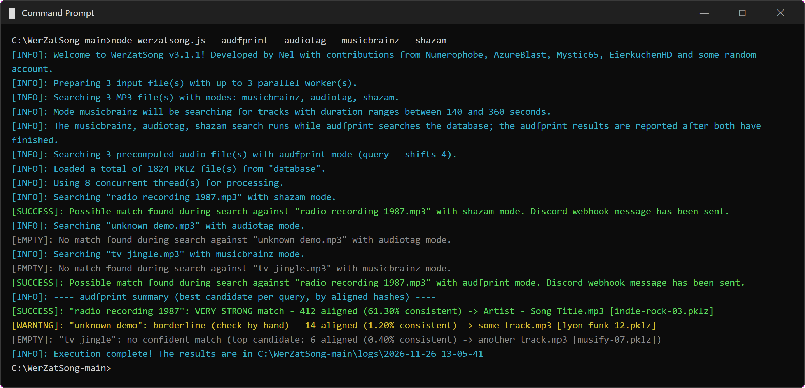

<div align="center">

# WerZatSong

**Find out the name of a song when all you have is a recording of it.**

[](https://github.com/LostwaveItalia/WerZatSong/stargazers)
[](https://github.com/LostwaveItalia/WerZatSong/network/members)
[](https://github.com/LostwaveItalia/WerZatSong/commits/main)
[](https://github.com/LostwaveItalia/WerZatSong/commits/main)

[](LICENSE)


<br>



</div>

> **Per chi parla italiano:** una traduzione completa di questo documento è disponibile in [**README_ITA.md.**](translated_READMEs/README_ITA.md)

> **Pour les francophones:** une traduction intégrale de ce document est disponible dans [**README_FRA.md.**](translated_READMEs/README_FRA.md)

> **Para quem fala português:** uma tradução completa deste documento está disponível em [**README_POR.md.**](translated_READMEs/README_POR.md)

---

Put your recordings into a folder, type one command, and WerZatSong searches for each song in up to four ways. What it finds is saved as text files on your computer and, if you like, posted to a Discord channel of your choice.

| Search | How it searches | Needs |
|---|---|---|
| **Audfprint** | Compares your songs with a large collection of song fingerprints, on your own computer | The fingerprint database |
| **Audiotag** | Online, at audiotag.info | A free Audiotag key |
| **MusicBrainz** | Online, in the AcoustID / MusicBrainz database | A free AcoustID key |
| **Shazam** | Online, with Shazam | Nothing extra |

You can use one search or several at once. Audfprint runs entirely on your computer; the other three send your recordings, or fingerprints made from them, to those online services. The setup is done once. The steps are written for Windows; on macOS and Linux, use the Terminal and type `python3` and `pip3` where this guide says `python` and `pip` (WerZatSong finds `python3` by itself).

---

## Contents

- [Setup](#setup)
- [Searching for songs](#searching-for-songs)
- [Understanding the results](#understanding-the-results)
- [PKLZ credits](#pklz-credits)
- [All options](#all-options)
- [The settings file (.env)](#the-settings-file-env)
- [Updating WerZatSong](#updating-werzatsong)
- [When something goes wrong](#when-something-goes-wrong)
- [Credits and license](#credits-and-license)

---

## Setup

### 1. Install Node.js, Python and FFmpeg

WerZatSong needs three free programs:

| Program | What it's for |
|---|---|
| [**Node.js**](https://nodejs.org) 20 or newer (the **LTS** version) | Runs WerZatSong itself |
| [**Python**](https://www.python.org/downloads) 3.13 or newer | Runs the fingerprinting and the Shazam search |
| [**FFmpeg**](https://www.gyan.dev/ffmpeg/builds) | Reads and cuts audio files |

On Windows, the easiest way is to open **Command Prompt** (press the Windows key, type `cmd`, press Enter) and type these one at a time:

```
winget install OpenJS.NodeJS.LTS
winget install Python.Python.3.13
winget install Gyan.FFmpeg
```

<details>
<summary><b>Installing them by hand instead</b></summary>

<br>

Download each program from the links above. In the Python installer, tick **"Add python.exe to PATH"** on the first screen. FFmpeg comes as a ZIP file without an installer: unzip it somewhere permanent (for example `C:\ffmpeg`) and add its `bin` folder to PATH:

1. Press the Windows key, type **environment variables** and open **Edit the system environment variables**.
2. Click **Environment Variables...**, select **Path** in the upper list and click **Edit...**.
3. Click **New**, type the path of the `bin` folder (for example `C:\ffmpeg\bin`) and click **OK** in every window.

</details>

Then open a **new** Command Prompt window and type these one at a time. Each should print a version number:

```
node -v
npm -v
python --version
pip --version
ffmpeg -version
```


If one says *"is not recognized as an internal or external command"*, Windows can't find that program (it isn't on its "PATH"). Install it again and open a new Command Prompt window.

### 2. Download and install WerZatSong

1. On this page, click the green **<> Code** button → **Download ZIP**, and unzip it to a folder of your choice, for example `C:\WerZatSong-main`. *(If you know Git, `git clone https://github.com/LostwaveItalia/WerZatSong.git` makes [updating](#updating-werzatsong) easier.)*
2. Open the folder in File Explorer, click in the address bar at the top, type `cmd` and press Enter. A Command Prompt window opens in that folder. All commands from here on are typed there.
3. Type these one at a time:

   ```
   npm install
   pip install -r requirements.txt
   pip install audioop-lts
   pip install shazamio
   ```

<details>
<summary><b>One of the <code>pip install</code> commands failed?</b></summary>

<br>

It is usually one of these two:

**An error that mentions Rust.** Install Rust from [rust-lang.org](https://www.rust-lang.org/tools/install), check it with `rustc --version` in a new Command Prompt window, and run the `pip install` commands again.


**An error that mentions Microsoft Visual C++ or build tools.** Install the [Build Tools for Visual Studio](https://visualstudio.microsoft.com/visual-cpp-build-tools/) and tick **"Desktop development with C++"** in the installer. Restart the computer and run the `pip install` commands again.


</details>

### 3. Get a Discord webhook and your keys

All three are optional: you only need a key for the search that uses it, and without a webhook the results are only saved on your computer (see [Running without a webhook or a key](#running-without-a-webhook-or-a-key)).

**A Discord webhook** is a private address that lets WerZatSong post in one channel of your server:

1. In Discord, create your own server if you don't have one (the **+** at the bottom of the server list).
2. Next to a text channel, click the gear icon (**Edit Channel**) → **Integrations** → **Webhooks** → **New Webhook**.
3. Click the new webhook, then **Copy Webhook URL**.

**An Audiotag key** (for the Audiotag search): create a free account at [audiotag.info](https://audiotag.info), open the [user section](https://user.audiotag.info) → **API keys** → **Create new API key**, and copy the key.

**An AcoustID key** (for the MusicBrainz search): create a free account at [acoustid.org](https://acoustid.org), open [My Applications](https://acoustid.org/my-applications) → **Register a new application**, fill in the fields with anything, click **Register** and copy the **API key**.

### 4. First start

Type:

```
node werzatsong.js --audiotag --musicbrainz
```

WerZatSong creates the folders it needs (`input`, `database`, `logs` and a few working folders) and its [settings file](#the-settings-file-env), and asks you to paste the webhook URL and the two keys (right-click pastes in Command Prompt). If something you paste isn't right, it says so and asks again. The webhook is only saved after WerZatSong has posted a welcome message with it, and the Audiotag key only after Audiotag has accepted it. Then it stops because the `input` folder is still empty. That is expected.


### 5. Add the fingerprint database

Only needed for the Audfprint search. Download the database folders from [wzs.cosine.club](https://wzs.cosine.club) and put them, as they are, into the `database` folder (the files inside end in `.pklz`). The database takes a lot of disk space and is read completely on every Audfprint search, so it is much faster on an SSD than on an external or older hard drive.

To keep the database somewhere else, for example on another drive, write that folder as `DATABASE_FOLDER` in `utils/consts.js` (for example `'D:/pklz'`, `'/Volumes/Drive/pklz'` or `'~/pklz'`).


---

## Searching for songs

1. **Put your songs into the `input` folder**: up to **30 MP3 files** per search. Other formats are ignored, so convert them first: typing `ffmpeg -i "my song.flac" "my song.mp3"` in Command Prompt (in the folder where the file is) makes an MP3 copy of any audio file. Simple file names work best.

2. **Start the search** with the searches you want, for example all four:

   ```
   node werzatsong.js --audfprint --audiotag --musicbrainz --shazam
   ```

   Add `--language Italiano`, `--language Português` or `--language Français` to get everything WerZatSong shows and writes in that language (see [Languages](#languages)).

3. **Wait until it says "Execution complete!"** Closing the window stops the search. The online searches post as soon as they find something; Audfprint takes the longest and posts at the end. A MusicBrainz search takes about five minutes per song, because the AcoustID service only answers a few questions per second.

> [!NOTE]
> Don't click inside the Command Prompt window while it runs: Windows pauses the program while text is selected there. If it seems stuck, press **Esc**.

4. **Empty the `input` folder** before the next batch. WerZatSong leaves your files there, and the next search would search them again.

### Running without a webhook or a key

WerZatSong asks for the webhook on every run that doesn't have one, and for an API key only when its search is in the command: a search with only `--audfprint` or `--shazam` never asks for a key.

- **`--no-discord`** posts nothing on Discord for this run and doesn't ask for a webhook. The results are still saved in `logs`. To post only some messages, write `--no-discord keep-match` (only matches) or `--no-discord keep-nomatch` (only "no match found"); these need a webhook. `--no-discord all` is the same as `--no-discord`.
- **`--no-prompt`** never stops to ask anything, for runs nobody is watching (scripts, scheduled runs). It uses what the settings file has: without a webhook nothing is posted; a search whose key is missing is skipped with a warning, and the others run as usual. If no chosen search is left, it stops.

For example, with an empty settings file this runs Audfprint and Shazam, skips Audiotag and MusicBrainz, and posts nothing:

```
node werzatsong.js --audfprint --musicbrainz --audiotag --shazam --no-prompt
```

To add a webhook or key later, run WerZatSong once without these options and paste it when asked, or write it in the [settings file](#the-settings-file-env).

### Languages

WerZatSong speaks English, Italian, Portuguese (Brazilian) and French. Add `--language` with `English`, `Italiano` / `Italian`, `Português` / `Portuguese` or `Français` / `French`; capital letters and accents don't matter (`--language portugues` works too). The messages, `--help`, the setup questions, the result files and the Discord messages are then all in that language. A language WerZatSong doesn't have is reported in English, and the search carries on in English.

To translate WerZatSong into another language, or improve a translation, see [TRANSLATION_GUIDE.md](TRANSLATION_GUIDE.md). A new translation file works as soon as it is in the `localizations` folder.

---

## Understanding the results

Every search gets its own folder inside `logs`, named after the date and time it started (for example `logs/2026-11-25_14-03-51`), with one text file per song and search that found something: `<song>.audfprint.txt`, `<song>.audiotag.txt`, `<song>.musicbrainz.txt` and `<song>.shazam.txt`. MusicBrainz writes one line per match with its score and AcoustID link, Audiotag writes the match as Audiotag sends it, and Shazam writes the song it found.

If the search has a webhook, matches are also posted to Discord, and a short message says so when a song has no match. Discord only gets the most reliable matches; the text files also list the doubtful ones.

### Audfprint results

The Audfprint file lists every candidate, the most likely first, after a short legend. Each entry has three lines:

```
[VERY STRONG] 59 aligned / 61 raw (96.72%) | x1 | #0 | azureblast-variety-mix-vol-1500.pklz | offset 31.27s
Some Song.mp3 (files/@transmit13/Some Song.mp3)
Credits: fingerprinted by AzureBlast (sheet) | suggested by S3V3R3DH3AD (sheet)
```

The first line says how good the match is, the second which song it is (with its path when it was fingerprinted), and the third [who made the fingerprints](#pklz-credits).

| Label | Meaning | Posted to Discord |
|---|---|---|
| **VERY STRONG** | Almost certainly the same recording | Yes |
| **STRONG** | Very likely the same recording | Yes |
| **PROBABLE** | Likely, but worth listening to | Yes |
| **BORDERLINE** | Could be chance; worth a listen only if nothing better was found | No, file only |
| **NO MATCH** | Below every threshold | No, file only |

<details>
<summary><b>What the numbers on the first line mean</b></summary>

<br>

- **aligned**: how many small pieces of sound (fingerprint "hashes") matched *at the same moments* in both recordings. This is the main evidence; 15 or more usually means a real match.
- **raw**: all the pieces both recordings have in common, lined up or not.
- **%** (consistency): aligned divided by raw. Unrelated recordings stay below about 1%; matches below 2% are never posted.
- **x1**: how many times the two recordings were found to line up.
- **#0**: where the match came in Audfprint's first ranking. Context, not confidence.
- **the .pklz file**: the database file the match came from.
- **offset**: where your recording lines up with the match, in seconds (negative: yours starts earlier).

In every language the words are translated, but the fields and their order stay the same.

</details>

> [!IMPORTANT]
> Always listen before you trust a result, especially a PROBABLE one.

---

## PKLZ credits

The fingerprint files are made by people from the community, and finding good sources takes time too. The credits line of each Audfprint result says who did it:

- **fingerprinted by**: who made the PKLZ file, as claimed on the [Lostwave Fingerprints sheet](https://docs.google.com/spreadsheets/d/1JtbAJhd78Ji18LMKVmKrRbGEq_Q1zB7SrnIbCXrihxc/edit?usp=sharing).
- **possibly fingerprinted by**: only a guess, used when nothing sure is known.
- **suggested by**: who suggested the source, when the sheet says so for sure.
- **no credits known for this pklz**: nothing says who made it or suggested it.

Each part ends with where it comes from: `(credit file)`, `(credits-overrides.tsv)`, `(sheet)`, `(wzs.cosine.club)`, `(built-in list)`, `(file name)`, `(database folder)` or `(song path)`. The sheet is the main source; the result files link to it so any credit can be checked.

**Keeping them current:** the credits come with WerZatSong (`resources/credits/pklz-credits.tsv`), which is updated from the sheet every hour, so updating WerZatSong brings the newest credits. A search never downloads anything. To get what the sheet says right now, double-click **`update-credits.cmd`** on Windows or run **`sh update-credits.sh`** on macOS and Linux (`npm run credits:update` works everywhere). It also fills in missing credits in your earlier result files in `logs`, without changing names already there.

**Fixing a credit:** on one computer, create `credits-overrides.tsv` in the WerZatSong folder with one line per PKLZ file: its name, who fingerprinted it, who claimed it and who suggested it, separated by tabs (several names separated by `, `). For everyone, fill in the sheet: its claimed by, suggested by and PKLZ filename columns are all WerZatSong needs.

<details>
<summary><b>Credit files that come with a package of PKLZ files</b></summary>

<br>

A package of PKLZ files can come with a small `.wzsc` credit file next to it that says who fingerprinted them and who suggested their source, for the whole package or for single files. WerZatSong reads every credit file in the `database` folder, and their credits come before everything else, `credits-overrides.tsv` included. A package's names cover every PKLZ file in the credit file's folder and the folders inside it, and each listed file is also found by its checksum anywhere in the `database` folder, so renaming a file or moving the credit file changes nothing. What a credit file doesn't say, such as who suggested a source, still comes from the sheet when it says so for sure. A credit file that can't be read is skipped with a warning.

</details>

<details>
<summary><b>What happens when the sheet changes</b></summary>

<br>

- **A new row** is added.
- **An edited row** replaces what it said before; a cell that was emptied keeps the name it had.
- **A deleted row** is still known: every row the sheet ever had is kept, so a row taken off the sheet takes no credits with it.
- **Rows, tabs or columns moved around** change nothing: a row is known by what it is about (its YouTube channel ID, otherwise its URL, title, ID range or tag, and the kind of tab), and columns by their headers.
- **The sheet emptied or deleted:** nothing is lost, for the same reason.
- **The sheet suddenly naming someone else for many sources at once** (more than 5% of its rows, or more than 200 when that's more), as a damaged or vandalized sheet would: nothing changes, and the update says why. If the changes are right, run it again with `--force` (`npm run credits:update -- --force`).

</details>

<details>
<summary><b>For maintainers</b></summary>

<br>

- **`.github/workflows/update-credits.yml`**: every hour, GitHub reads the sheet, runs `npm run credits:build` and commits `resources/credits/pklz-credits.tsv` when something changed. If the sheet can't be downloaded, the run ends with a warning and nothing changes. If the sheet names someone else for many sources at once, the run fails; when those changes are right, start the workflow by hand from the **Actions** tab with *force* ticked.
- **`npm run credits:build`**: the same by hand. It looks every PKLZ file in the credits file up again and never takes anything out. `-- --sheet <file or link>` reads a downloaded copy of the sheet (`.xlsx`, its HTML export or `.csv` files) or another link. `-- --fresh --list <file> --list <file>` rebuilds the file from lists of PKLZ files (filetrees of database folders or one path per line, newest first), which must include the contents of the archives some files come in, like the Reverbnation batches. `--report <file>` also writes where every credit came from. It ends with exit code 3 when the sheet can't be downloaded.
- **`npm run credits:report -- --database <folder>`**: lists the credits every PKLZ file in a folder would get, and how each was found. `--tree <file>` reads the names from a list instead, and `--logs <folder>` goes through earlier result files.
- **`npm run credits:update`** also takes `-- --save <file>` (keep a copy of the sheet) and `-- --logs <folder>` or `-- --database <folder>` (use other folders). All of these work with `--language`.
- The sheet's link is `CREDITS_SHEET` at the top of `utils/credits.js`. It is only read, so it has to stay shared with "Anyone with the link" as a viewer.
- The rules for names are in `utils/creditsRules.js`: `PEOPLE` (the name shown for each nickname), `FAMILIES` (packs whose makers are known; add a pack when someone says it's theirs), `SHEET_MAKERS` (names on the sheet whose PKLZ files are all made by the same people, whoever claimed the rows), `NAMING_STYLES` (file name styles only one person uses), `NAMED_MAKERS` (ways of naming PKLZ files that tell who made them), `PATH_MAKERS` (stored song paths that tell who made a PKLZ file), `OWN_FOLDERS` (folders whose PKLZ files are all made by one person) and `FOLDER_FAMILIES` (folders that hold one person's PKLZ files, which only ever give *possibly*).

</details>

---

## All options

Options go after `node werzatsong.js`. `node werzatsong.js --help` lists them all.

| Option | What it does | Default |
|---|---|---|
| `--audfprint`, `--audiotag`, `--musicbrainz`, `--shazam` | Choose the searches (at least one) | |
| `--language <language>` | The language of everything WerZatSong shows and writes, see [Languages](#languages) | English |
| `--trim <seconds>` | Uses only the first part of each song, for example `--trim 60`. Makes long recordings faster to search. | the whole song |
| `--no-discord [all \| keep-match \| keep-nomatch]` | Posts nothing (or only some messages) on Discord, see [above](#running-without-a-webhook-or-a-key) | |
| `--no-prompt` | Never asks anything, see [above](#running-without-a-webhook-or-a-key) | |
| **Audfprint** | | |
| `--folder <name>` | Searches only one folder inside `database`, written relative to it (`--folder "genres/indie-rock"`), or just its name when only one folder has it. Upper and lower case don't matter. | the whole database |
| `--threads <number>` | How many database files are searched at the same time (at most 16; fewer when memory is short) | the computer's processor threads |
| `--shifts <1–8>` | How carefully your songs are fingerprinted. Higher finds more but is slower. | 4 |
| `--shard-timeout <minutes>` | How long one database file may take before it is skipped and reported | 15 |
| `--resume` | Continues a stopped search, see below | |
| `--merge <folder>` | Database maintenance, see below | |
| **MusicBrainz** | | |
| `--duration <min:max>` | Song lengths in seconds to look for (30 to 600). For a short song try `"30:200"`, for a long one `"300:600"`. | `"140:360"` |
| `--extension <seconds>` | Adds this many seconds before the song is fingerprinted; can help when the recording starts late (1 to 25) | 10 |

### Continuing a stopped search: `--resume`

If an Audfprint search stops before it is finished (the window was closed, the computer restarted, it crashed), type:

```
node werzatsong.js --audfprint --resume
```

It searches only the database files that were not finished, keeps what was found before, and reports everything as usual. It also lists the songs the other searches hadn't searched yet. It only works if you haven't started another search in between: a new search replaces what `--resume` needs.

### Faster Audfprint searches

- `pip install isal` makes reading the database about three times faster. It is used by itself once installed.
- `--folder` searches one part of the database instead of all of it, and `--shifts 2` fingerprints your songs more quickly.
- `--merge <folder>` (advanced; mainly for folders of very small PKLZ files) combines the PKLZ files of a database folder (named as with `--folder`, or `""` for the whole database) into a few large ones, in a new folder `<folder>__merged` next to it. It only merges and then stops. Searches of the whole database keep using the originals; search the merged copy with `--folder "<folder>__merged"`. Each merged file gets a small `.sources.json` file next to it, so its matches keep their credits. `--shard-files <number>` (default 64) sets how many files go into each merged file, and `--max-dropped <percent>` (default 3) discards a merged file that would lose more than that share of its fingerprints.
- More switches are in the [settings file](#the-settings-file-env).

---

## The settings file (.env)

WerZatSong keeps its settings in the file `.env` in its folder. Open it with Notepad (right-click → **Open with** → **Notepad**); each line is `NAME=value`.

| Setting | What it is |
|---|---|
| `WEBHOOK_URL` | The Discord webhook the results are posted to |
| `AUDIOTAG_KEY` | Your Audiotag key |
| `ACOUSTID_KEY` | Your AcoustID key; several keys can be separated by commas |
| `NODE_COMMAND`, `PYTHON_COMMAND`, `FFMPEG_COMMAND` | How Node.js, Python and FFmpeg are started (normally `node`, `python`, `ffmpeg`). For a program that isn't on PATH, put its full path, for example `C:\ffmpeg\bin\ffmpeg.exe`. |
| `DISK_PRIORITY=normal` | *Optional, Windows only:* reads the database at full speed even when WerZatSong was started by a program running it in the background at low priority |
| `SEQUENTIAL_MODES=on` | *Optional:* runs the online searches first and Audfprint after them, instead of at the same time |
| `FAST_INFLATE=off` | *Optional:* doesn't use isal even when it is installed |
| `VERIFY_CHECKSUMS=always` | *Optional:* checks every database file for damage on every search. Without it (and without isal), each file is checked the first time it is read and about once a month after that. |

> [!CAUTION]
> The `.env` file contains your keys and your webhook. Never share it: anyone with the webhook address can post in your channel.

---

## Updating WerZatSong

1. Download the new version as a ZIP.
2. In your WerZatSong folder, **keep** `.env`, `database`, `logs`, `cache` and `credits-overrides.tsv` (if you made one), and **replace everything else** with the new files. Never replace only some files: a mix of old and new files leads to confusing errors that look like bugs. If you moved the database with `DATABASE_FOLDER`, set it again in the new `utils/consts.js`.
3. Type `npm install` and `pip install -r requirements.txt` again.

With Git, steps 1 and 2 are just `git pull` in the WerZatSong folder. What changed in each version is in [CHANGELOG.md](CHANGELOG.md).

---

## When something goes wrong

<details>
<summary><b>"... is not recognized as an internal or external command"</b></summary>

<br>

Windows can't find that program. See [step 1 of the setup](#1-install-nodejs-python-and-ffmpeg), then open a new Command Prompt window.

</details>

<details>
<summary><b>"Too many MP3 files! Limit per each search is 30 files..."</b></summary>

<br>

Search the rest in a second batch. The limit is there because everything an Audfprint search finds is kept in memory until the end, and that grows with every song: hundreds of songs at once can run out of memory ("JavaScript heap out of memory") and lose the whole search.

</details>

<details>
<summary><b>"... is already using this WerZatSong install"</b></summary>

<br>

Another search is still running from the same folder, maybe in another window. Wait for it to finish.

</details>

<details>
<summary><b>An "invalid" webhook URL or API key</b></summary>

<br>

WerZatSong asks again: copy it again from Discord or the website, without spaces. A webhook URL starts with `https://discord.com/api/webhooks/`. Keys already saved can be fixed in the [settings file](#the-settings-file-env).

</details>

<details>
<summary><b>Nothing arrives in Discord</b></summary>

<br>

Check that the command has no `--no-discord`, and check `WEBHOOK_URL` in the [settings file](#the-settings-file-env). If the webhook was deleted in Discord, make a new one.

</details>

<details>
<summary><b>A file "is too short to be precomputed" or was skipped</b></summary>

<br>

The recording is too short or almost silent for a fingerprint. The other files are still searched.

</details>

<details>
<summary><b>"Nothing to resume"</b></summary>

<br>

There is no stopped search to continue (see [`--resume`](#continuing-a-stopped-search---resume)). Start a normal search.

</details>

**Anything else:** tell the maintainers what you typed and everything the Command Prompt window showed. Command Prompt may cut off the start of a long output; to keep all of it, add `> output.txt 2>&1` to the end of the command and send the `output.txt` file it creates.

---

## Credits and license

Developed by **Nel** with contributions from **Numerophobe**, **AzureBlast**, **Mystic65**, **EierkuchenHD** and **some random account**. Italian translation by **some random account**, French translation by **jacktorrance_overlook**; the Brazilian Portuguese translation is a work in progress.

WerZatSong is released under the [MIT License](LICENSE). The bundled programs in `libs` keep their own licenses: audfprint (`libs/audfprint`) by Dan Ellis, and fpcalc (`libs/fpcalc`) from the Chromaprint project.
